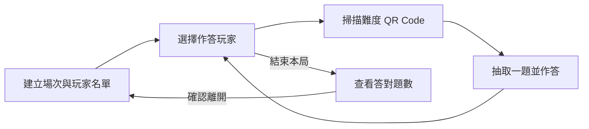

# Uma-Rescue

無人機教育桌遊「拯救烏瑪城」的 Unity 數位輔助系統與研究資料。

本專案將實體桌遊活動與數位問答結合：玩家選擇作答者、掃描難度 QR Code、回答無人機相關題目，系統透過 Firebase 保存學習歷程，並在場次結束時顯示答對題數。現有 App 採最多 4 位玩家共用裝置的操作方式。

研究文件涵蓋 STEM 與遊戲式學習、Dijkstra 路徑概念、認知負荷、心流狀態及問卷分析。儲存庫同時收錄 Unity 原始碼、教學流程、題庫、研究紀錄、成果報告與論文，方便開發、活動執行與研究資料查閱。

[核心功能](#核心功能) · [快速開始](#快速開始) · [題庫與紀錄](#題庫與紀錄) · [專案結構](#專案結構) · [研究資料](#研究資料) · [維護與授權](#維護與授權)

## 核心功能

| 功能 | 現有行為 |
| --- | --- |
| 場次與玩家 | 在大廳輸入玩家名稱，建立 Firebase 場次；每次作答前手動選擇玩家。 |
| QR 難度選擇 | 使用相機與 ZXing 解析 QR Code，依 `qL1`、`qL2`、`qL3` 選擇難度。 |
| 隨機抽題 | 每次掃描抽取一題；各難度分別記錄已出題號，用完該難度題庫後重置。 |
| 作答回饋 | 顯示選項、單題能量獎勵、正誤顏色及音效，完成後返回玩家選擇。 |
| 學習歷程 | 保存題號、玩家、是否答對、作答秒數與時間，並送出 Firebase Analytics 答題事件。 |
| 結果圖表 | 使用 XCharts 顯示各玩家答對題數；先顯示本機分數，再以 Firebase 紀錄更新。 |
| 本機狀態 | 使用 PlayerPrefs 保存場次、玩家名稱及答對題數，支援場景切換時恢復資料。 |

App 的實作重心是問答與紀錄。實體桌遊的零件蒐集、移動成本與路徑決策由[教學流程與研究設計](docs/teaching/README.md)說明，研究主題與文件版本可從[研究導覽](docs/research/README.md)查閱。

### 操作流程



| 場景 | 用途 |
| --- | --- |
| `LobbyScene` | 輸入玩家、建立場次。 |
| `SelectPlayerScene` | 選擇本次作答玩家，或結束本局查看結果。 |
| `ScanScene` | 開啟相機，解析難度 QR Code。 |
| `GameScene` | 載入題目、作答、提供回饋與上傳紀錄。 |
| `ResultScene` | 顯示答對題數圖表，確認後清除本機場次狀態並返回大廳。 |

五個場景均已加入 [Editor Build Settings](ProjectSettings/EditorBuildSettings.asset)。

## 快速開始

### 環境與依賴

| 項目 | 儲存庫設定 |
| --- | --- |
| Unity | **2022.3.36f1**，以 [ProjectVersion.txt](ProjectSettings/ProjectVersion.txt) 為準。 |
| Git LFS | 取得 PDF、圖片、音效及原生函式庫等二進位資源。 |
| Firebase Unity SDK | **13.6.0**；App 使用 Realtime Database 與 Analytics。 |
| ZXing | `Assets/Plugins/zxing.dll`，組件版本 **0.16.11.0**，用於 QR 解碼。 |
| XCharts | 內附版本 **3.14.0**；套件清單亦保留 Git 來源依賴。 |
| TextMesh Pro | 套件版本 **3.0.6**，用於文字與輸入介面。 |
| 執行環境 | 需能連線 Firebase，並具備可用的相機；相機權限由程式於掃描時請求。 |

完整套件來源與鎖定資訊見 [manifest.json](Packages/manifest.json) 與 [packages-lock.json](Packages/packages-lock.json)。Android 設定使用套件名稱 `com.teacher.quizgame`、最低 SDK 23；進行 Android 建置時需安裝 Unity 對應的 Android Build Support。

### 1. 取得專案

先安裝 Git 與 Git LFS，再執行：

```powershell
git lfs install
git clone https://github.com/Erfin13/DroneGame.git
cd DroneGame
git lfs pull
```

在 Unity Hub 加入 clone 後的 **DroneGame 根目錄**，以 Unity 2022.3.36f1 開啟，等待套件與資源匯入。

### 2. 設定 Firebase 與題庫

1. 確認 Firebase 專案與執行平台設定相符。Android 的 `Assets/google-services.json` 由開發者配置，已列入 `.gitignore`。
2. 核對 [GlobalVariables.cs](Assets/Scripts/Core/GlobalVariables.cs) 中的 `DATABASE_URL`；目前網址直接設定在程式內。
3. 準備可讀取題目、建立 `game_sessions` 及寫入作答紀錄的資料庫環境。
4. 依[題庫與紀錄](#題庫與紀錄)核對 JSON 結構。現有載入器從資料庫根節點讀題；題庫包裝與非題目節點的處理方式見下方說明。

平台設定與操作步驟詳見[環境設定文件](docs/setup.md)。

### 3. 執行一個場次

1. 開啟 `Assets/Scenes/LobbyScene.unity`，進入 Play 模式。
2. 輸入玩家名稱並建立場次；空白輸入會使用預設學生名稱。
3. 選擇本次作答玩家，允許相機存取，掃描難度碼。
4. 選擇答案，查看正誤回饋，再返回玩家選擇進行下一次作答。
5. 在玩家選擇畫面結束本局，查看各玩家答對題數。

| 難度 | QR Code 內容範例 |
| --- | --- |
| 1 | `QUIZ|qid=qL1` |
| 2 | `QUIZ|qid=qL2` |
| 3 | `QUIZ|qid=qL3` |

掃描器也可解析網址中的 `qid=` 參數。現有流程使用難度碼，`qL1_01` 等單一題號不作為掃描入口。

## 題庫與紀錄

### 題庫來源

| 檔案 | 題數 | 結構與用途 |
| --- | ---: | --- |
| [活動題庫](data/question-banks/workshop/題目.json) | 297 | 題號直接位於根節點，難度 1、2、3 各 99 題；包含單題獎勵。 |
| [範例題庫](data/question-banks/drone_quiz.json) | 20 | 題目包在 `questions` 物件內，作為獨立範例保存。 |
| [題庫文件](docs/teaching/question-bank/題目.docx) | — | 活動題庫的文件版本，供教學查閱。 |

題目資料的結構範例如下；`correctOptionIndex` 從 0 起算：

```json
{
  "qL1_01": {
    "questionText": "無人機起飛前應先檢查什麼？",
    "options": ["外殼顏色", "電池與機身狀況", "貼紙數量", "遊戲版本"],
    "correctOptionIndex": 1,
    "difficultyLevel": 1,
    "type": "quiz",
    "reward": 1
  }
}
```

[QuizManager.cs](Assets/Scripts/Features/Quiz/QuizManager.cs) 目前遍歷資料庫根節點，將每個子節點解析為題目，沒有向下讀取 `questions`，也沒有先排除 `game_sessions` 等非題目節點。部署時需讓題庫讀取位置與節點篩選一致；將 20 題範例整份匯入 `questions` 下，並不符合目前載入方式。調整資料結構時，應同步調整讀取程式並保留既有場次紀錄。

### 場次與答題紀錄

場次保存於 `game_sessions/{sessionID}`，包含 `timestamp` 與 `students`；每題作答保存於 `game_sessions/{sessionID}/answers/{answerID}`：

```json
{
  "question_id": "qL1_01",
  "student": "學生_1",
  "is_correct": true,
  "time_taken": 2.4,
  "timestamp": "14:03:11"
}
```

`time_taken` 為作答耗時秒數。Analytics 事件名稱為 `question_answered`，包含題號、正誤、耗時、學生名稱與時間。本機保存的是場次與答對題數；題目載入、建立場次與上傳紀錄需使用 Firebase。

[原始答題紀錄](data/research/README.md)中的 `成果檔案.json` 在第 978 行、第 5 欄解析失敗，保留原始內容供追溯，不能直接當作完整 JSON 匯入。詳細欄位、來源狀態與格式差異見[資料格式說明](docs/data-formats.md)。

## 專案結構

```text
DroneGame/
├── Assets/
│   ├── Scripts/              App 程式
│   │   ├── Core/             共用場次與玩家狀態
│   │   ├── Models/           題目、場次與作答模型
│   │   ├── Infrastructure/   Firebase 初始化與上傳
│   │   ├── Features/         大廳、玩家、掃描、問答與結果
│   │   └── UI/               相機及結束場次確認視窗
│   ├── Scenes/               五個主要場景
│   └── ...                   介面、音效、字型與第三方套件
├── Packages/                 Unity 套件與鎖定資訊
├── ProjectSettings/          Unity 專案與平台設定
├── docs/                     設定、架構、計畫、教學及寫作範本
├── data/                     題庫與原始答題紀錄
├── reports/                  前後測分析與研究成果報告
├── papers/                   TANET 論文與主題參考文獻
└── artifacts/                原有 Burst 除錯資料
```

主要程式入口：

| 模組 | 程式 |
| --- | --- |
| 場次與共用狀態 | [LobbyManager](Assets/Scripts/Features/Lobby/LobbyManager.cs)、[GlobalVariables](Assets/Scripts/Core/GlobalVariables.cs) |
| 玩家選擇 | [SelectPlayerManager](Assets/Scripts/Features/Players/SelectPlayerManager.cs) |
| QR 掃描 | [QRScanManager](Assets/Scripts/Features/Scanning/QRScanManager.cs)、[ScanSceneController](Assets/Scripts/Features/Scanning/ScanSceneController.cs) |
| 抽題與作答 | [QuizManager](Assets/Scripts/Features/Quiz/QuizManager.cs) |
| Firebase 事件與紀錄 | [FirebaseManager](Assets/Scripts/Infrastructure/Firebase/FirebaseManager.cs) |
| 結果統計 | [ResultManager](Assets/Scripts/Features/Results/ResultManager.cs) |

場景、程式責任與資料流詳見[系統架構](docs/architecture.md)。

## 研究資料

研究文件以「開發以學習人工智慧路徑演算法之無人機教育桌遊系統」為主題，涵蓋設計、教學執行與學習評估。計畫及 TANET 稿件討論認知負荷與心流；成果報告初稿與前後測資料另涵蓋自我效能、合作學習、運算思維、合作問題解決及科技接受度。

| 閱讀目的 | 入口 |
| --- | --- |
| 了解研究脈絡與閱讀順序 | [研究導覽](docs/research/README.md) |
| 查閱計畫、申請表件與參考專題 | [研究計畫](docs/research/planning/README.md) |
| 執行桌遊活動、查閱教材 | [教學資料](docs/teaching/README.md) |
| 查閱前測與後測統計 | [分析報告](reports/analysis/README.md) |
| 閱讀成果報告初稿 | [研究成果](reports/README.md) |
| 查閱 TANET 原稿、修訂稿與參考文獻 | [論文與文獻](papers/README.md) |
| 使用報告或學位論文範本 | [寫作範本](docs/templates/README.md) |

36 個原始研究檔案保留原稿、修訂稿、不同格式及同內容來源副本。修訂稿與初稿依來源標示，不據此宣告為正式定稿。[完整索引](docs/archive/file-index.md)、[版本說明](docs/archive/versions.md)與[來源清單](docs/archive/research-files.json)提供現行位置、原始來源及 SHA-256。

## 維護與授權

維護規則見 [CONTRIBUTING.md](CONTRIBUTING.md)。搬移 Unity 資源時需連同 `.meta` 保留 GUID；新增或調整研究文件位置時，同步更新索引與來源清單，保留原始資料版本。二進位資源依 `.gitattributes` 使用 Git LFS。

修改執行行為後，應以「建立場次 → 玩家選擇 → 相機掃描 → 作答上傳 → 結果圖表」完整流程驗證。本 README 依儲存庫中的程式、場景與文件說明功能；平台建置與執行結果仍需在對應環境確認。

儲存庫目前沒有根目錄的開源授權檔；[原有專案說明](docs/legacy/README-before-organization.md)標示用途為教學或內部使用。第三方元件依各自附帶的授權，包括 [XCharts 的 MIT 授權](Assets/XCharts-master/LICENSE.md)與 [External Dependency Manager 的 Apache 2.0 授權](Assets/ExternalDependencyManager/Editor/LICENSE)。
