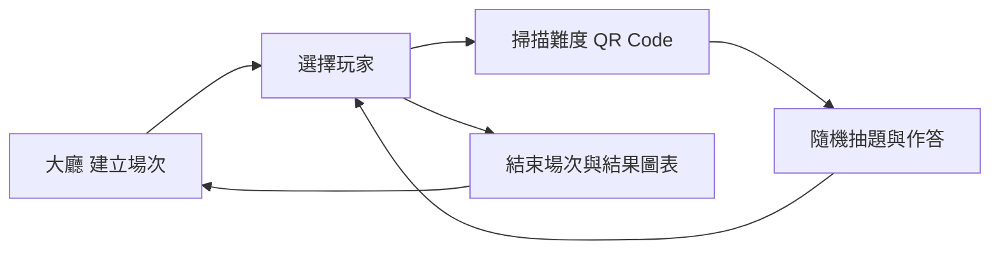

# DroneGame 無人機教育桌遊研究專案

此儲存庫整合無人機教育桌遊的 Unity 問答應用與國科會研究資料。應用以 QR Code 選擇難度、從 Firebase 載入題目並記錄作答；研究資料依計畫、活動、資料分析與成果的順序編排。

## 從這裡開始

| 目的 | 入口 |
| --- | --- |
| 閱讀研究計畫、教材與論文 | [國科會研究資料總覽](國科會/README.md) |
| 開啟與設定遊戲 | [環境設定與操作流程](docs/setup.md) |
| 理解程式分層與場景 | [系統架構](docs/architecture.md) |
| 使用題庫與答題紀錄 | [資料格式](docs/data-formats.md) |
| 查詢檔案原始位置與保留檢查 | [整理規則與驗證](docs/organization.md) |

## 儲存庫結構

```text
DroneGame/
├── Assets/                    Unity 資源與按功能分層的程式
│   ├── Scripts/
│   │   ├── Core/              共用狀態
│   │   ├── Models/            題目、場次與作答模型
│   │   ├── Infrastructure/    Firebase 整合
│   │   ├── Features/          大廳、玩家、掃描、問答與結果
│   │   └── UI/                確認視窗
│   ├── Scenes/               五個遊戲場景
│   └── ...                   音效、介面、外部套件與其他資源
├── Packages/                 Unity 套件清單
├── ProjectSettings/          Unity 設定
├── data/question-banks/      20 題範例題庫
├── 國科會/
│   ├── 01_計畫與申請/
│   ├── 02_活動與教材/
│   ├── 03_資料與分析/
│   ├── 04_研究成果/
│   ├── 05_參考文獻/
│   └── 06_寫作範本/
├── docs/                     設定、架構、格式、整理與來源對照
└── artifacts/burst-debug/    原有 Burst 除錯資料留存
```

Unity 專案仍以儲存庫根目錄開啟。腳本與其 `.meta` 一起搬移，原有 GUID、場景與資源內容保留。

## 遊戲流程



專案版本為 Unity **2022.3.36f1**。QR Code 使用 `qid=qL1`、`qid=qL2`、`qid=qL3`，對應三個難度。遊戲讀取 Firebase 根節點下的題目，作答寫入 `game_sessions/{sessionID}/answers`。題庫包裝的差異與原始紀錄狀態詳見資料格式說明。

## 檔案保留

36 個研究原始檔案、全部既有程式與資源都已保留；只調整目錄與閱讀入口。同內容來源副本、原稿、修訂稿、DOCX、PDF、DOC、ODT 與 JSON 皆各自留存。PDF 沿用原有 Git LFS，研究資料保留原始位元組。

[搬移清單](docs/file-moves.json)記錄新舊路徑與 SHA-256。[先前 README](docs/legacy/README-before-organization.md)完整留存供歷史查閱，現行操作以本頁與 `docs/` 為準。

## 授權

沿用原專案說明：此專案為教學或內部使用用途。研究來源文件與第三方套件的原有授權資訊保留於各自檔案中。
