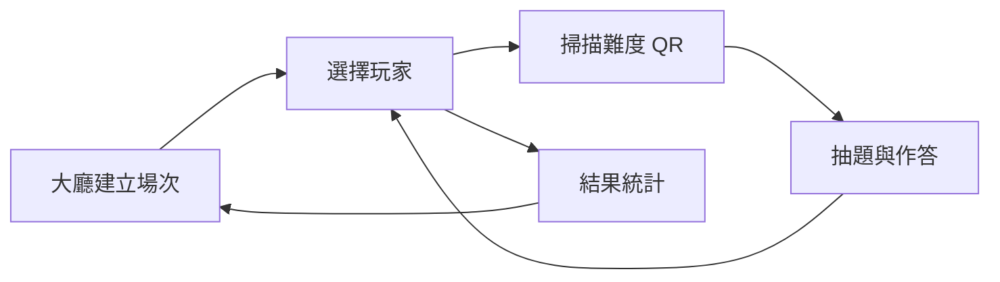

# DroneGame

Unity 問答與 QR 掃描應用，支援無人機教育桌遊及人工智慧路徑演算法教學。本儲存庫整合應用程式、教學設計、題庫、研究紀錄、分析報告與論文，按用途分開管理。

## 快速入口

| 工作 | 入口 |
| --- | --- |
| 開啟遊戲與設定環境 | [Getting started](docs/setup.md) |
| 理解程式與場景 | [Architecture](docs/architecture.md) |
| 閱讀研究文件 | [Research guide](docs/research/README.md) |
| 查閱教學流程 | [Teaching materials](docs/teaching/README.md) |
| 使用題庫與原始紀錄 | [Data](data/README.md) · [Data formats](docs/data-formats.md) |
| 查閱分析與成果報告 | [Reports](reports/README.md) |
| 查閱論文與參考文獻 | [Papers](papers/README.md) |

## Repository layout

```text
DroneGame/
├── Assets/                   Unity 場景、程式、介面與外部資源
│   └── Scripts/
│       ├── Core/             共用狀態
│       ├── Models/           題目、場次與作答模型
│       ├── Infrastructure/   Firebase 整合
│       ├── Features/         大廳、玩家、掃描、問答與結果
│       └── UI/               共用確認視窗
├── Packages/                Unity 套件清單
├── ProjectSettings/         Unity 專案設定
├── docs/
│   ├── research/planning/   計畫、申請表件與參考專題
│   ├── teaching/            教學流程、課程申請與題庫文件
│   ├── templates/           報告與論文撰寫範本
│   └── archive/             檔案索引、來源與版本對照
├── data/
│   ├── question-banks/      範例題庫與活動題庫 JSON
│   └── research/            原始答題紀錄
├── reports/
│   ├── analysis/            前測、後測統計報告
│   └── research/            研究成果報告
├── papers/
│   ├── tanet/               論文原稿與修訂稿
│   └── references/          依研究主題分類的參考文獻
└── artifacts/               原有 Burst 除錯資料
```

Unity Hub 仍以儲存庫根目錄開啟專案。使用 **Unity 2022.3.36f1**，clone 後執行 `git lfs pull` 取得二進位資源。完整設定見 [Getting started](docs/setup.md)。

## Application flow



QR Code 使用 `qid=qL1`、`qid=qL2`、`qid=qL3`。程式從 Firebase 根節點讀取題目，答題寫入 `game_sessions/{sessionID}/answers`。20 題範例和 297 題活動題庫的 JSON 包裝不同，詳見 [Data formats](docs/data-formats.md)。

## Document and data provenance

原稿、修訂稿、來源副本與不同文件格式全部保留；原始中文檔名可由 [File index](docs/archive/file-index.md) 查閱。[Research file manifest](docs/archive/research-files.json) 記錄 36 個原始研究檔案的現行位置、來源與 SHA-256。原有 `成果檔案.json` 的解析問題保留並記錄於資料格式說明。

[Organization](docs/organization.md) 說明編排與保留檢查。程式與資源內容、Unity GUID、場景與專案設定保留；本次僅整理 repo，尚未進行 Unity 執行測試。

## Maintenance

目錄、Unity 資源與研究資料的維護規則見 [Contributing](CONTRIBUTING.md)。

## License

沿用原專案說明：此專案為教學或內部使用用途。原有說明留存於 [Legacy README](docs/legacy/README-before-organization.md)；第三方資源的授權保留於各自檔案中。
