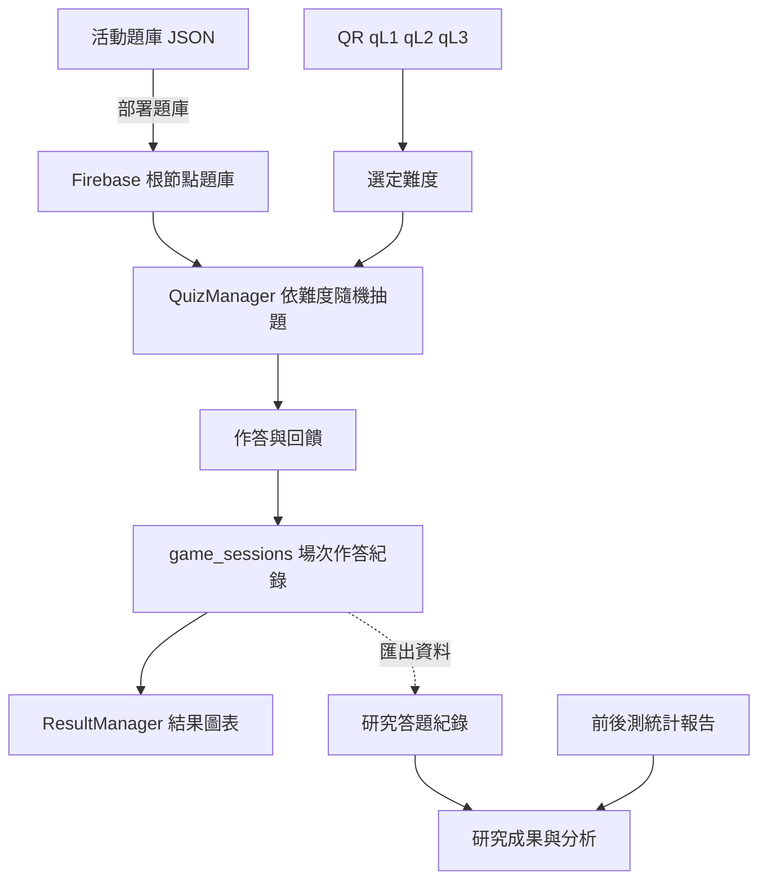

# 系統架構

本專案以 Unity 問答應用支援無人機教育桌遊，研究資料包含計畫、活動流程、題庫、問卷分析與成果文件。目錄按程式責任與研究流程整理；本次不修改遊戲邏輯。

## 程式分層

| 分層 | 路徑 | 責任 |
| --- | --- | --- |
| 共用狀態 | `Assets/Scripts/Core/GlobalVariables.cs` | 玩家、場次、難度、能量、使用過的題目與本機作答狀態。 |
| 模型 | `Assets/Scripts/Models/` | `SessionData`、`AnswerData`、執行期 `Question` 與 `QuestionData` 資產。 |
| Firebase 整合 | `Assets/Scripts/Infrastructure/Firebase/FirebaseManager.cs` | Firebase 初始化與答題紀錄上傳；大廳、問答、結果也各自使用資料庫。 |
| 大廳 | `Assets/Scripts/Features/Lobby/LobbyManager.cs` | 玩家輸入、建立場次與進入玩家選擇。 |
| 玩家 | `Assets/Scripts/Features/Players/SelectPlayerManager.cs` | 指定本次作答玩家、進入掃描與結束場次。 |
| 掃描 | `Assets/Scripts/Features/Scanning/` | 相機、QR 解碼、難度解析與轉場。 |
| 問答 | `Assets/Scripts/Features/Quiz/QuizManager.cs` | 根節點題庫載入、依難度抽題、重複題控制、作答回饋。 |
| 結果 | `Assets/Scripts/Features/Results/ResultManager.cs` | 讀取場次作答紀錄，以 XCharts 展示統計。 |
| 共用介面 | `Assets/Scripts/UI/` | `CameraConfirmPanel`、`ConfirmDialog`。 |

程式分層是目錄分類，不代表已新增服務抽象或改寫依賴。Firebase SDK、External Dependency Manager、TextMesh Pro、XCharts 及 Plugins 維持既有位置與內容。

## 場景與轉場

| 場景 | 主要用途 | 正常流程 |
| --- | --- | --- |
| `LobbyScene` | 輸入玩家、建立場次 | 前往 `SelectPlayerScene`。 |
| `SelectPlayerScene` | 選擇玩家 | 前往 `ScanScene`，或結束進入 `ResultScene`。 |
| `ScanScene` | 掃描難度碼 | 有效碼設定難度，預設前往 `GameScene`；返回按鈕前往大廳。 |
| `GameScene` | 顯示題目與作答 | 完成後回到玩家選擇；載入錯誤也會返回。 |
| `ResultScene` | 場次統計 | 結束後回到大廳。 |

五個場景均已列在 `ProjectSettings/EditorBuildSettings.asset`。場景檔與 Build Settings 未搬移或改寫。

## 資料流

圖中的研究資料關係表示用途；本次沒有重新匯入 Firebase、重新計算統計或產生新研究結果。原始 `成果檔案.json` 的格式問題記錄於資料格式說明。

## Unity 引用保留

13 個腳本及其 `.meta` 成對搬移，原有 GUID 不變。新增功能目錄附有資料夾 `.meta`。Assets 根目錄、Resources、StreamingAssets、場景、套件與專案設定保持原位置；原有 Burst 除錯文字資料移至 `artifacts/burst-debug/`，20 題範例移至 `data/question-banks/`。

驗證包含所有既有檔案的 SHA-256、腳本 GUID、場景引用及 Markdown 連結。這些靜態檢查不等同實際啟動 Unity、相機或 Firebase 的執行測試。

[返回專案總覽](../README.md)
